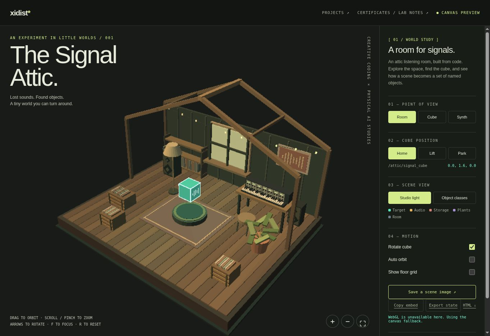
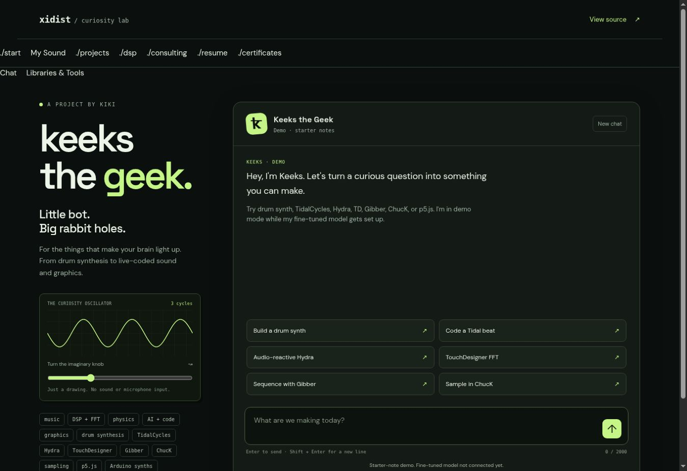

# taw-002 · The Artist’s Way / TouchDesigner

**Updated 2026-11-09** · Kidist Wosenyeleh / Kiki / xidist

An evolving archive of visual experiments, guitar interfaces, source prototypes, and the notes that connect them.

- [The Artist’s Way — illustrated website](https://xidist.xyz/artists-way.html)
- [All 25 projects: dated READMEs, links, and previews](projects/README.md)
- [Personal Notion workbook · TAWWB: TD](https://www.notion.so/1ffa70bb517c8029a262cb07f2ee8fcc) — current project overview, weekly assignments, and session prompts.
- [Practice, workbook, and learning resources](ARTISTS_WAY.md)
- [Reusable practice-log template](docs/practice-log-template.md)
- [Patreon products and TikTok Shop status](docs/commerce-links.md)
- [Portfolio constellation](https://xidist.xyz/) · [TouchDesigner network](https://xidist.xyz/touchdesigner.html) · [Résumé](https://xidist.xyz/resume.html)

## A few windows into the work

Chroma Portal — synthetic test render; live webcam and TouchDesigner testing pending.

The Signal Attic — browser capture showing the Canvas fallback.

Keeks the Geek — authored-note demo interface.

## Dates and availability

Every project README has a dated documentation update and links to its source and site. Original note dates and repository creation dates are labeled separately. Screenshots retain their context; missing captures are marked pending.

Twelve Patreon product links are recorded in the November 9, 2026 store handoff. TikTok Shop product URLs remain pending; the TikTok profile is listed separately.

## Original workspace and learning archive

### [hermarshaspeaks: touchdesigner](https://www.notion.so/hermarshaspeaks-touchdesigner-92b1b5bea2334999abe600b15e7c68cf?source=copy_link)

https://www.instagram.com/hermarshaspeaks?igsh=MW1zbzd4a2F0a2VqbQ%3D%3D&utm_source=qr

Learn:

[taw: td | day: 29/84 | week: 05/12](hermarshaspeaks%20touchdesigner/taw%20td%20day%2029%2084%20week%2005%2012%201ffa70bb517c80168a1dcfd7b7b0627e.md)

[[**The 100 Series: TouchDesigner Fundamentals**](https://learn.derivative.ca/courses/100-fundamentals/)](hermarshaspeaks%20touchdesigner/The%20100%20Series%20TouchDesigner%20Fundamentals%201faa70bb517c8022bc4ad72d8186682d.md)

[Portfolio](hermarshaspeaks%20touchdesigner/Portfolio%2035da70bb517c808e8cc5dfe4628e3571.md)

Create:

[td projects](hermarshaspeaks%20touchdesigner/td%20projects%20f53668f197054b88a9cc5be3441d987c.csv)

## td projects

- [caustics - luke heckaman](hermarshaspeaks%20touchdesigner/td%20projects/caustics%20-%20luke%20heckaman%208e25533b9a2c4f1d826334f898c34904.md)
- [chord finger harmonies](hermarshaspeaks%20touchdesigner/td%20projects/chord%20finger%20harmonies%20360a70bb517c803797dbcca5280877d0.md)
- [FILM GRAIN](hermarshaspeaks%20touchdesigner/td%20projects/FILM%20GRAIN%2035ea70bb517c801bb4a7c3351dea913d.md) | [assets](hermarshaspeaks%20touchdesigner/td%20projects/FILM%20GRAIN)
- [finger colorshift](hermarshaspeaks%20touchdesigner/td%20projects/finger%20colorshift%20361a70bb517c80309256d2c4686dc069.md) | [assets](hermarshaspeaks%20touchdesigner/td%20projects/finger%20colorshift)
- [layout](hermarshaspeaks%20touchdesigner/td%20projects/layout%2035fa70bb517c809b8ee4fef6d8cf985e.md) | [assets](hermarshaspeaks%20touchdesigner/td%20projects/layout)
- [media pipe intro](hermarshaspeaks%20touchdesigner/td%20projects/media%20pipe%20intro%20360a70bb517c805abc56c230589ae770.md) | [assets](hermarshaspeaks%20touchdesigner/td%20projects/media%20pipe%20intro)
- [mediapipe touchdesigner](hermarshaspeaks%20touchdesigner/td%20projects/mediapipe%20touchdesigner%20522854bc038e4eecbfa769a9bc5c4804.md)
- [Page 3](hermarshaspeaks%20touchdesigner/td%20projects/Page%203%20a87ba64adf4641a59ff8e8c55a905c5a.md)
- [resources](hermarshaspeaks%20touchdesigner/td%20projects/resources%2079b829c0020b44cc93aaddbdb60332bf.md)
- [risograph - supermarketsallad](hermarshaspeaks%20touchdesigner/td%20projects/risograph%20-%20supermarketsallad%2035ca70bb517c807d80a3f2d88a1288bc.md) | [assets](hermarshaspeaks%20touchdesigner/td%20projects/risograph%20-%20supermarketsallad)
- [signal rot](hermarshaspeaks%20touchdesigner/td%20projects/signal%20rot%20362a70bb517c80f8b812e13d4b784b48.md) | [assets](hermarshaspeaks%20touchdesigner/td%20projects/signal%20rot)
- [THE MATRIX](hermarshaspeaks%20touchdesigner/td%20projects/THE%20MATRIX%20361a70bb517c80a3999ede23b9560db5.md) | [assets](hermarshaspeaks%20touchdesigner/td%20projects/THE%20MATRIX)
- [water](hermarshaspeaks%20touchdesigner/td%20projects/water%20360a70bb517c802b9178c1359fad6946.md) | [assets](hermarshaspeaks%20touchdesigner/td%20projects/water)

