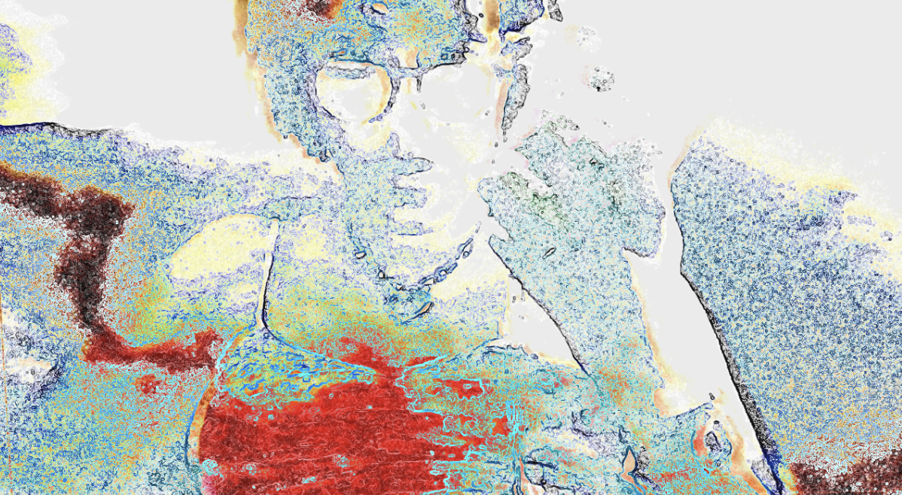

# Film Grain

An experimental edge-and-luminance animation with rough, glitchy motion.

**Documentation updated:** 2026-11-09  
**Original note created:** 2026-05-12  
**Stage / edition:** Animated GIF asset

## Links

- [Website project / collection entry](https://xidist.xyz/touchdesigner.html#grain)
- [Source files / original notes](https://github.com/xidist/taw-002/blob/main/hermarshaspeaks%20touchdesigner/td%20projects/FILM%20GRAIN%2035ea70bb517c801bb4a7c3351dea913d.md)
- [The Artist’s Way gallery](https://xidist.xyz/artists-way.html)
- [Dated project entry](../dates/2026-05-12/film-grain/README.md)
- [Source repository](https://github.com/xidist/taw-002)
- [Repository README](../../README.md)
- [All project READMEs](../README.md)

## Preview

Film Grain workspace screenshot from May 12, 2026. The Patreon product is the rendered GIF edition.
Preview indexed: 2026-11-09. This is not a new capture-date claim.

## Contents and setup

- film-grain.gif — original 600 × 312 animation
- Local browser preview and usage notes

**Requirements:** A browser or creative tool that supports animated GIFs. TouchDesigner is optional.

**Current limits:** Rendered GIF edition at the stated native resolution. No editable .toe project, audio, HD/4K export, or custom adaptation is included. The animation is also visible as a public portfolio preview.

## Patreon and TikTok

- [Patreon product — $5 USD](https://www.patreon.com/xidist/posts/film-grain-gif-5-174828481)
- Recorded available in the store handoff dated 2026-11-09. The exact publication timestamp is not recorded here.
- TikTok Shop product link: **pending / no submitted listing recorded as of 2026-11-09**.
- [TikTok profile](https://www.tiktok.com/@xidist.xyz) — a social profile, not a Shop product checkout.
- [Dated store-link register](../../docs/commerce-links.md). Fixed-price downloads and custom consulting are separate offers.
