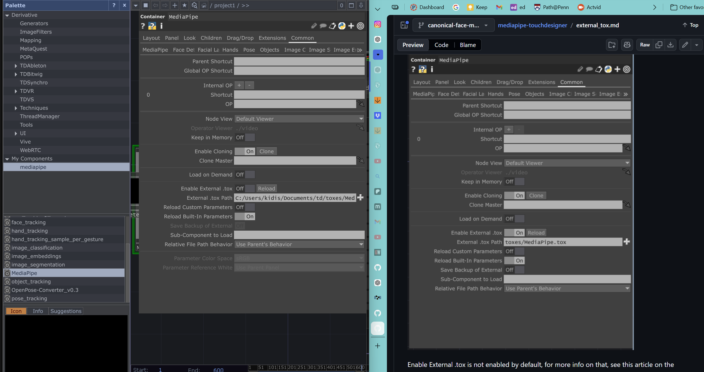

# Finger Colorshift

Map a normalized finger position to a circular hue palette for your own visuals.

**Documentation updated:** 2026-11-09  
**Original note created:** 2026-05-15  
**Stage / edition:** Gesture color source kit

## Links

- [Website project / collection entry](https://xidist.xyz/touchdesigner.html#colorshift)
- [Source files / original notes](https://github.com/xidist/taw-002/blob/main/hermarshaspeaks%20touchdesigner/td%20projects/finger%20colorshift%20361a70bb517c80309256d2c4686dc069.md)
- [The Artist’s Way gallery](https://xidist.xyz/artists-way.html)
- [Dated project entry](../dates/2026-05-15/finger-colorshift/README.md)
- [Source repository](https://github.com/xidist/taw-002)
- [Repository README](../../README.md)
- [All project READMEs](../README.md)

## Preview

Historical finger-tracking workspace. The Patreon product contains the gesture-to-color mapping starter.
Preview indexed: 2026-11-09. This is not a new capture-date claim.

## Contents and setup

- gesture_color.py — original calibrated gesture-to-RGB functions
- palette.json — twelve named RGB anchors
- TouchDesigner connection recipe

**Requirements:** Python 3 for the mapper. TouchDesigner and your separately installed tracker for live gesture input.

**Current limits:** Source-only starter edition. No camera tracker, historical .toe, full feedback composition, or prebuilt .tox is included. The mapping math is checked; live TouchDesigner integration is not verified.

## Patreon and TikTok

- [Patreon product — $5 USD](https://www.patreon.com/xidist/posts/finger-gesture-5-174828562)
- Recorded available in the store handoff dated 2026-11-09. The exact publication timestamp is not recorded here.
- TikTok Shop product link: **pending / no submitted listing recorded as of 2026-11-09**.
- [TikTok profile](https://www.tiktok.com/@xidist.xyz) — a social profile, not a Shop product checkout.
- [Dated store-link register](../../docs/commerce-links.md). Fixed-price downloads and custom consulting are separate offers.
