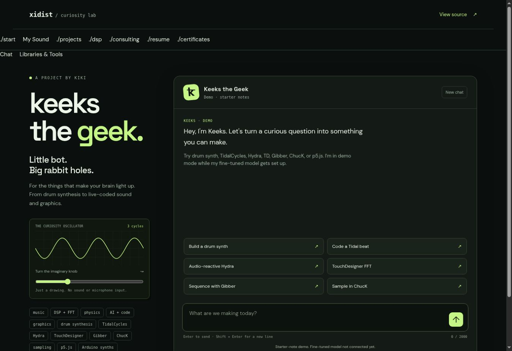

# Keeks the Geek

Build from an authored-note chatbot demo and an experimental QLoRA training/evaluation pipeline.

**Documentation updated:** 2026-11-09  
**Repository created (UTC):** 2026-11-08  
**Stage / edition:** Chatbot + training source kit

## Links

- [Website project / collection entry](https://xidist.xyz/keeks/)
- [Source files / original notes](https://github.com/xidist/keeks-the-geek)
- [Implementation README](https://github.com/xidist/keeks-the-geek/blob/main/README.md)
- [The Artist’s Way gallery](https://xidist.xyz/artists-way.html)
- [All project READMEs](../README.md)

## Preview

Keeks browser demo screenshot. This shows the authored-note interface, not a trained-model evaluation.
Preview indexed: 2026-11-09. This is not a new capture-date claim.

## Contents and setup

- Browser demo with 185 authored notes
- Training/validation data, source catalogs and Colab notebook
- Training, evaluation and API scripts
- CPU/browser tests and model/dataset documentation

**Requirements:** Browser and Python for demo use. Compatible NVIDIA/CUDA/PyTorch environment and separately acquired compute/model dependencies for training.

**Current limits:** No trained model or adapter is included. The browser retrieves starter notes; it does not generate answers with a fine-tuned model. GPU execution and quality improvement are unverified.

## Patreon and TikTok

- [Patreon product — $19 USD](https://www.patreon.com/xidist/posts/keeks-geek-kit-174828698)
- Recorded available in the store handoff dated 2026-11-09. The exact publication timestamp is not recorded here.
- TikTok Shop product link: **pending / no submitted listing recorded as of 2026-11-09**.
- [TikTok profile](https://www.tiktok.com/@xidist.xyz) — a social profile, not a Shop product checkout.
- [Dated store-link register](../../docs/commerce-links.md). Fixed-price downloads and custom consulting are separate offers.
