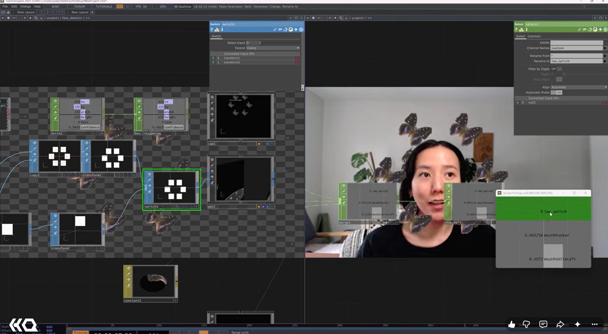

# MediaPipe Intro

Early face-tracking and virtual-camera experiments documented with workspace screenshots.

**Documentation updated:** 2026-11-09  
**Original note created:** 2026-05-14  
**Stage / edition:** Historical study / notes

## Links

- [Website project / collection entry](https://xidist.xyz/artists-way.html#media-pipe-intro)
- [Source files / original notes](https://github.com/xidist/taw-002/blob/main/hermarshaspeaks%20touchdesigner/td%20projects/media%20pipe%20intro%20360a70bb517c805abc56c230589ae770.md)
- [The Artist’s Way gallery](https://xidist.xyz/artists-way.html)
- [All project READMEs](../README.md)

## Preview

Archived project media; capture date is not established unless stated in its filename.
Preview indexed: 2026-11-09. This is not a new capture-date claim.

## Contents and setup

- Original notes and available saved media

**Requirements:** See the original project notes for environment and dependencies.

**Current limits:** Archived process material; completion and present-day runtime compatibility are not asserted.

## Patreon and TikTok

- No project-specific Patreon listing is recorded for this entry. [Creator page](https://www.patreon.com/c/xidist).
- TikTok Shop product link: **pending / no submitted listing recorded as of 2026-11-09**.
- [TikTok profile](https://www.tiktok.com/@xidist.xyz) — a social profile, not a Shop product checkout.
- [Dated store-link register](../../docs/commerce-links.md). Fixed-price downloads and custom consulting are separate offers.
