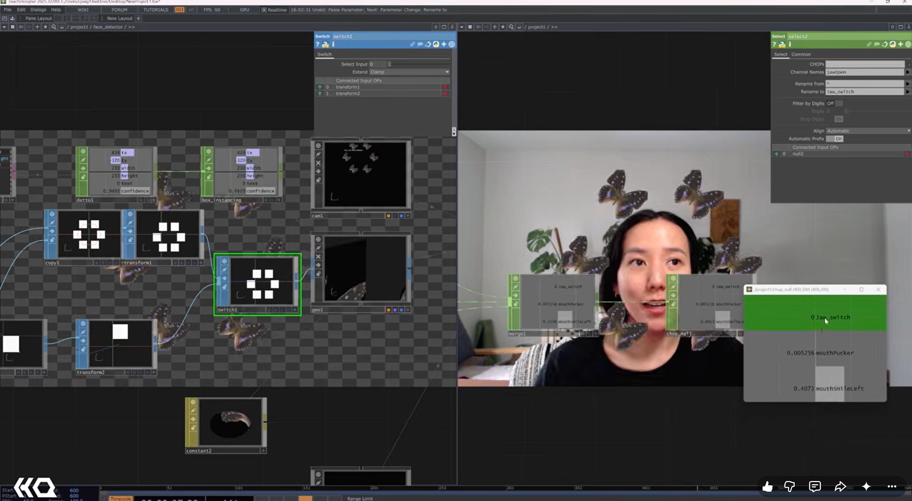

# MediaPipe + Camera

A compact calibration toolkit for turning an existing camera-tracking channel into a stable 0–1 creative control.

**Documentation updated:** 2026-11-09  
**Original note created:** 2023-11-28  
**Stage / edition:** Control mapping source kit

## Links

- [Website project / collection entry](https://xidist.xyz/touchdesigner.html#mediapipe)
- [Source files / original notes](https://github.com/xidist/taw-002/blob/main/hermarshaspeaks%20touchdesigner/td%20projects/mediapipe%20touchdesigner%20522854bc038e4eecbfa769a9bc5c4804.md)
- [The Artist’s Way gallery](https://xidist.xyz/artists-way.html)
- [All project READMEs](../README.md)

## Preview

Historical camera-routing study. The Patreon calibration helper is a separate source-kit edition.
Preview indexed: 2026-11-09. This is not a new capture-date claim.

## Contents and setup

- calibration.py with finite-value checks, clamping, smoothing, and tracking-loss behavior
- Calibration worksheet and sample data
- TouchDesigner integration guide

**Requirements:** Python 3 for the math helper. For live tracking: your own webcam, TouchDesigner and the separately installed upstream MediaPipe plugin.

**Current limits:** This is an original mapping helper and guide, not the MediaPipe plugin, a tracker model, or a prebuilt .tox. No OBS/phone-camera setup service is included.

## Patreon and TikTok

- [Patreon product — $5 USD](https://www.patreon.com/xidist/posts/mediapipe-camera-174828507)
- Recorded available in the store handoff dated 2026-11-09. The exact publication timestamp is not recorded here.
- TikTok Shop product link: **pending / no submitted listing recorded as of 2026-11-09**.
- [TikTok profile](https://www.tiktok.com/@xidist.xyz) — a social profile, not a Shop product checkout.
- [Dated store-link register](../../docs/commerce-links.md). Fixed-price downloads and custom consulting are separate offers.
