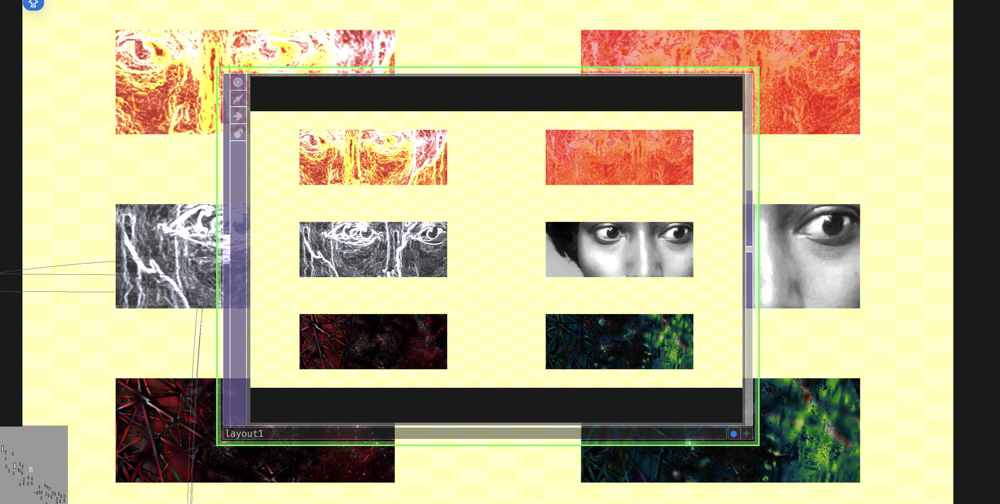

# Network Layout

A reusable planning template for readable TouchDesigner patches and clean handoffs.

**Documentation updated:** 2026-11-09  
**Original note created:** 2026-05-13  
**Stage / edition:** Workflow template kit

## Links

- [Website project / collection entry](https://xidist.xyz/touchdesigner.html#layout)
- [Source files / original notes](https://github.com/xidist/taw-002/blob/main/hermarshaspeaks%20touchdesigner/td%20projects/layout%2035fa70bb517c809b8ee4fef6d8cf985e.md)
- [The Artist’s Way gallery](https://xidist.xyz/artists-way.html)
- [Dated project entry](../dates/2026-05-13/network-layout/README.md)
- [Source repository](https://github.com/xidist/taw-002)
- [Repository README](../../README.md)
- [All project READMEs](../README.md)

## Preview

Historical network-layout screenshot. The downloadable planning template does not reorganize this patch.
Preview indexed: 2026-11-09. This is not a new capture-date claim.

## Contents and setup

- Editable network-plan.csv and network-template.json
- Python generator for a local HTML node-layout map
- README and handoff checklist templates

**Requirements:** Python 3 to regenerate the diagram, and a browser to view it. No TouchDesigner installation required to use the planning templates.

**Current limits:** Planning/template edition. It does not automatically reorganize or modify an existing .toe file. The original project screenshot is a reference, not an editable network.

## Patreon and TikTok

- [Patreon product — $5 USD](https://www.patreon.com/xidist/posts/network-layout-5-174828603)
- Recorded available in the store handoff dated 2026-11-09. The exact publication timestamp is not recorded here.
- TikTok Shop product link: **pending / no submitted listing recorded as of 2026-11-09**.
- [TikTok profile](https://www.tiktok.com/@xidist.xyz) — a social profile, not a Shop product checkout.
- [Dated store-link register](../../docs/commerce-links.md). Fixed-price downloads and custom consulting are separate offers.
