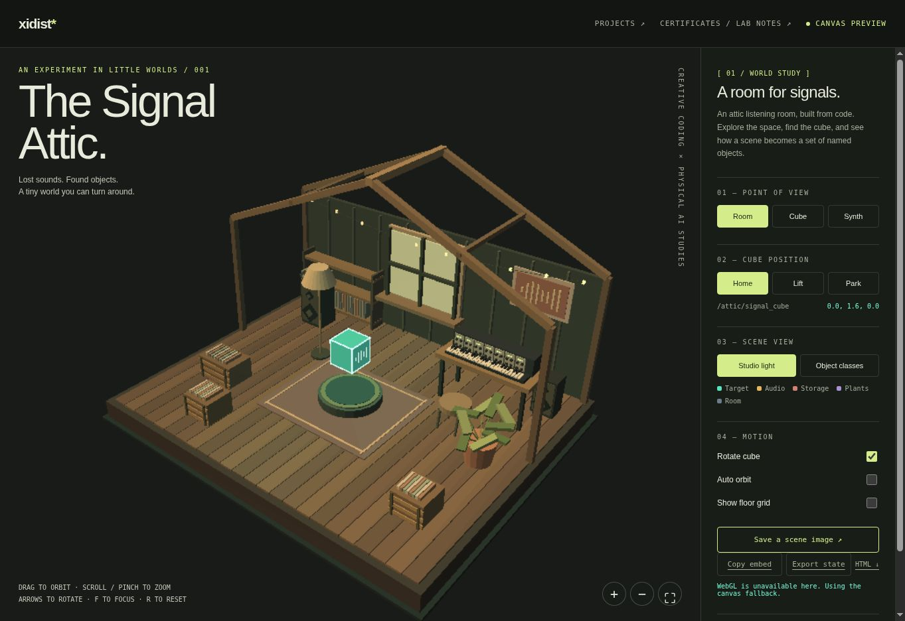

# The Signal Attic

An editable interactive browser studio with orbit controls, scene modes, object movement, and exports.

**Documentation updated:** 2026-11-09  
**Catalog recorded:** 2026-11-09  
**Stage / edition:** Browser world source

## Links

- [Website project / collection entry](https://xidist.xyz/world.html)
- [Source files / original notes](https://github.com/xidist/xidist.xyz/blob/main/world.html)
- [The Artist’s Way gallery](https://xidist.xyz/artists-way.html)
- [All project READMEs](../README.md)

## Preview

Signal Attic browser screenshot, showing the Canvas fallback renderer. Screenshot indexed November 9, 2026.
Preview indexed: 2026-11-09. This is not a new capture-date claim.

## Contents and setup

- Standalone world.html with WebGL and canvas fallback
- Local launch instructions and editable source

**Requirements:** A modern browser. WebGL for the primary renderer; the included canvas fallback is more limited.

**Current limits:** Existing source/demo edition. RTX/OpenUSD assets, NVIDIA certification, custom scenes, website integration, and hosting are not included.

## Patreon and TikTok

- [Patreon product — $15 USD](https://www.patreon.com/xidist/posts/signal-attic-15-174828646)
- Recorded available in the store handoff dated 2026-11-09. The exact publication timestamp is not recorded here.
- TikTok Shop product link: **pending / no submitted listing recorded as of 2026-11-09**.
- [TikTok profile](https://www.tiktok.com/@xidist.xyz) — a social profile, not a Shop product checkout.
- [Dated store-link register](../../docs/commerce-links.md). Fixed-price downloads and custom consulting are separate offers.
